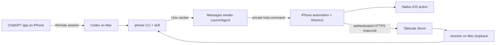

# Codex iOS Assistant

Codex iOS Assistant lets Codex on a Mac control an iPhone. The `iphone` CLI sends private commands through iMessage. An iOS Shortcut runs the requested action and returns context from your iPhone back to your Mac.

> [!TIP]
> This project is meant to be installed with Codex! To install it, please paste this message into a new Codex thread on your Mac:
>
> ```text
> Please set up the `dodongo/codex-ios-assistant` GitHub project. I want to get it working on my own Mac and iPhone with Tailscale Serve. Notify me when my input is required. Otherwise, please set up this project entirely on your own.
> ```

## Supported commands

- Capture the iPhone screen for direct image inspection.
- Read and replace the clipboard.
- List enabled alarms, create an alarm, or disable alarms at a given time.
- Open Camera, Weather, Calendar, Calculator, Messages, Find My, Spotify, Photos, Wallet, Notes, Books, App Store, Uber, and DoorDash.
- Open the Home Screen or Control Center; control timers, the flashlight, and Low Power Mode; place calls.
- Search Mac Contacts and read the Mac's Messages database.
- Inspect accessibility controls and tap them in finite paired UI sessions, including Tailscale sessions that continue from Wi-Fi onto cellular.

Message composition opens a draft for review. The CLI does not send ordinary messages, buy anything, install apps, order food, or request rides.

### Tailscale UI sessions

With Python 3.13+, install the optional transport using `.venv/bin/python -m pip install -e '.[tailnet]'`. Configure a trusted signed UI runner with `iphone ui configure`. While the unlocked phone is connected over trusted USB, create its RemotePairing record with `.venv/bin/pymobiledevice3 lockdown remotepairing --pair --udid '<paired UDID>'`, then restrict `~/.pymobiledevice3/` to mode `0700` and its pairing records to `0600`.

Start while the phone is on Wi-Fi and the native pairing is reachable:

```bash
iphone ui start --tailnet-address '<iPhone Tailscale IP>' --duration 600 --timeout 60
```

After startup succeeds, the phone can switch to cellular while that session remains active. All device interactions use `iphone ui request METHOD PATH --data '<JSON object>'`. Paths are session-relative; use `--scope device` for device-level endpoints. Add `--observe` for a post-request screenshot, accessibility controls, and snapshot ID. UI-dependent changes require that fresh, single-use `--snapshot`; explicit app activation and deep-link navigation do not. Prefer verified deep links over searching menus. Sessions stop on lock, expiry, or connection failure. Starting again requires Wi-Fi; this does not support cold starts on cellular.

Observed deep links with a `bundleId` wait for native UI idle for up to two seconds by default (`idleTimeoutMs` overrides this). Observations check the accessibility tree before and after the screenshot and retry capture, never the action, if the tree changes. Capture must settle within the observation timeout and session lifetime. Verify the returned screen and control values before claiming that a change succeeded.

```bash
iphone ui request POST /url --data '{"url":"App-prefs:com.openai.chat","bundleId":"com.apple.Preferences"}' --observe --json
iphone ui request POST /wda/keys --data '{"value":["ChatGPT"]}' --snapshot '<observation UUID>' --observe --json
```

## How it works



The Messages sender runs as a per-user LaunchAgent. This keeps Messages automation outside the Codex sandbox, where LaunchServices may be unable to resolve `com.apple.MobileSMS`.

See [Architecture and protocol](docs/architecture.md) for request formats and trust boundaries.

## Requirements

- A Mac running macOS 14 or newer, with Python 3.11+, Messages, and Xcode Command Line Tools.
- An iPhone that receives messages sent to the configured iMessage address.
- Tailscale signed into the same tailnet on the Mac and iPhone.
- MagicDNS and HTTPS enabled for the tailnet.
- iCloud sync for Shortcuts.

The ChatGPT desktop and mobile apps are required only for the Remote workflow.

## Install

```bash
git clone https://github.com/dodongo/codex-ios-assistant.git
cd codex-ios-assistant
brew install steipete/tap/imsg
./scripts/install
./scripts/setup-tailscale
./scripts/install-services
./scripts/copy-shortcut
```

Configuration has three values: the iMessage address that reaches your iPhone, the Mac's private Tailscale HTTPS origin, and a generated receiver token. The installer derives the origin from `tailscale status` and stores the values in `~/.config/codex-ios-assistant/`, outside the repository.

`scripts/copy-shortcut` puts 95 native Shortcuts actions on the Mac clipboard. Paste them once into a blank shortcut and name it `iOS Assistant`. After iCloud syncs it to your iPhone, create the automation that listens for commands:

1. Open Shortcuts > Automation, tap the plus sign at the bottom, then choose New Automation > Message.
2. Under `When I receive a message where`, set `Sender is` to your own iMessage contact.
3. Tap `Add Filter` and set `Message contains` to `hola`.
4. Tap `Run Shortcut` and select `iOS Assistant`.

You must create this automation by hand in the Shortcuts app on your iPhone. Follow the [installation guide](docs/installation.md) for the remaining Apple permissions.

## Test the setup

```bash
iphone doctor
curl http://127.0.0.1:8787/health
iphone home
iphone screen capture --timeout 30
iphone alarm list --timeout 30
```

`iphone home` returns `requested` after Messages accepts the command. Commands that wait for data from the phone, including `screen capture` and `alarm list`, return `completed` after the matching response reaches the Mac.

## Files

| Path | Contents |
| --- | --- |
| `src/iphone_cli/` | CLI, Messages bridge, receiver, and URL builders |
| `shortcut/actions.template.plist` | Sanitized 95-action Shortcut template |
| `scripts/` | Install, configuration, Tailscale Serve, LaunchAgent, and clipboard tools |
| `skills/iphone-control/` | Codex skill installed under `~/.agents/skills` |
| `contacts/` | Swift Contacts search helper |
| `tests/` | Python tests and Shortcut validation |

## Docs

- [Installation](docs/installation.md)
- [Commands](docs/commands.md)
- [Architecture and protocol](docs/architecture.md)
- [Shortcut maintenance](docs/shortcut.md)
- [Tailscale Serve](docs/tailscale.md)
- [Security](docs/security.md)
- [Troubleshooting](docs/troubleshooting.md)
- [Development](docs/development.md)

Released under the [MIT License](LICENSE).
